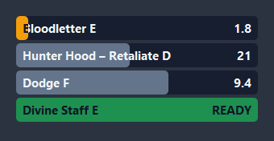
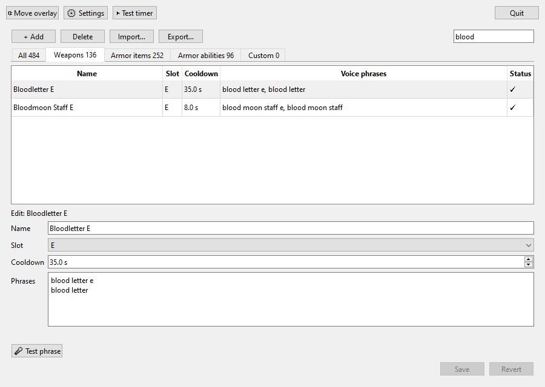
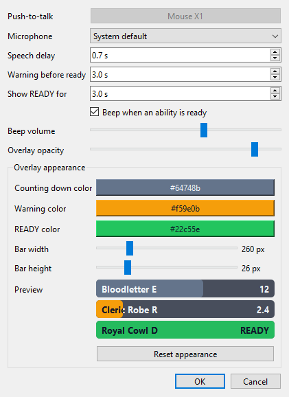

# PVPTimer

**Voice-triggered enemy cooldown timers for Albion Online.** Hold your push-to-talk key, say what the
enemy just used ("blood letter e", "dodge"), and a countdown bar appears on screen, so you know when
that ability is likely back.

- **Works offline.** Speech recognition runs on your PC; nothing is sent anywhere.
- **Comes with 484 abilities** already set up: every weapon's E, plus chest (R), helmet (D) and
  boots (F) abilities, generated from the game's own data.
- **Fits how you already play.** Use the same push-to-talk key as Discord, and your callout to the
  team starts the timer too.
- **Yours to change.** Edit cooldowns and phrases, add your own abilities, and pick bar colors and
  sizes.

## Download

1. Go to [**Releases**](https://github.com/twasser/albion-pvp-timer/releases/latest) and download
   `PVPTimer-x.y.z.zip`.
2. Unzip it anywhere (for example your Documents folder) and open the `PVPTimer` folder.

**You need:** Windows 10 or 11, a microphone, and Albion Online in **borderless fullscreen** or
**windowed** mode. No Python or other installs.

## Quick start

1. Double-click **PVPTimer.exe**.
   - Windows may say **"Windows protected your PC"**, because the app isn't code-signed yet. Click
     **More info → Run anyway**.
2. Pick your **push-to-talk** key or mouse side button when asked.
3. Hold push-to-talk, say **"blood letter e"**, and let go. A Bloodletter E timer appears on screen.
4. Click **⇕ Move overlay**, drag the bars where you want them, and click it again to lock them.
5. **Minimize** PVPTimer while you play. Closing it (✕ or **Quit**) stops the timers.

## Using PVPTimer

### Calling out abilities

| Say | What happens |
|---|---|
| A weapon name, with or without the slot: "blood letter e", "blood letter" | Starts that weapon's E timer |
| An item and its ability: "hunter hood retaliate" | Starts a timer for that item's ability |
| Just the ability: "dodge", "taunt r" | Starts one shared timer for that ability, whatever item it came from |
| The same phrase again | Restarts that timer |
| "clear" + a phrase: "clear blood letter e" | Removes that timer |
| "clear all" | Removes every timer |

Bars count down, turn **amber** in the last 3 seconds, then flash **READY** with a beep and fade out.

If nothing starts, a short message on the overlay says why:
- **"? not a saved phrase":** it heard you, but what you said isn't in your list.
- **"? heard nothing":** no speech came through. Check your microphone in Settings.

Cooldowns are the game's base values. Cooldown-reduction gear and buffs make the real ones shorter.

### The ability list

- **Tabs** split the list into **Weapons**, **Armor items**, **Armor abilities** and **Custom** (the
  ones you add). **Search** looks through names and phrases.
- **Change an ability:** click it, edit the cooldown or phrases (one per line), then **Save**. Your
  changes are kept even when PVPTimer updates its built-in list.
- **Delete a lot at once:** **Delete shown…** removes every ability currently listed. It follows the
  tab and the search box, so pick **Weapons** to clear just those, or leave **All** selected with an
  empty search to clear the whole list and start fresh. **Export…** first if you might want them back.
- **Add your own:** click **+ Add**, fill in a name, slot, cooldown and phrases, then **Save**. The form
  clears so you can add the next one.
- **🎤 Test phrase:** click it, hold push-to-talk and speak. It shows exactly what PVPTimer heard and
  which ability matched.
- **Status column:** **✓** is fine. **⚠ word** means a phrase uses a word the speech model doesn't
  know, so respell it with common words ("bloodletter" → "blood letter"). **⚠ dup** means two
  abilities share a phrase.
- **Import… / Export…** share ability lists with friends as a file.

### Settings

- **Always listen:** tick this to skip push-to-talk entirely. The microphone stays on while PVPTimer
  runs and every callout is picked up as you say it. Speech that doesn't match a saved phrase is
  ignored without any message. Phrases that could come up in normal conversation will start timers
  by accident, so favor distinctive ones ("dodge f" over "dodge").
- **Push-to-talk:** any key, or a mouse side or middle button. Not used while *Always listen* is on.
- **Microphone:** only microphones that work with PVPTimer are listed. "System default" follows
  Windows.
- **Speech delay:** how long it takes you to finish a callout after the enemy casts (default 0.7 s).
  It's subtracted from every timer.
- **Warning before ready / Show READY for / Beep:** when bars turn amber, how long READY stays, and the
  sound.
- **Overlay appearance:** colors for counting down, warning and READY, bar width and height, and a
  live preview. **Reset appearance** restores the defaults.
- **▶ Test timer** in the main window shows an 8-second sample bar on the overlay.

## Tips

- Short phrases like "dodge" are fastest, but if you share your Discord push-to-talk key, ordinary
  talk containing them can start a timer. If that happens, remove the one-word phrase from those
  abilities; "dodge f" still works.
- Single letters are easy to mishear. Give important abilities a couple of phrases.
- Everything is stored in `%APPDATA%\PVPTimer` (settings, your abilities, and a log), so it survives
  updating to a new version.

## Troubleshooting

| Problem | Fix |
|---|---|
| "Windows protected your PC" | Click **More info → Run anyway**. The app isn't code-signed, so Windows doesn't recognise it yet. |
| The overlay doesn't show in game | Switch Albion to **borderless fullscreen** or **windowed**. Exclusive fullscreen hides other windows; the beep still plays. |
| Push-to-talk does nothing while Albion is focused | Albion may be running as administrator. Run PVPTimer as administrator too, or run Albion normally. |
| "? heard nothing" | Pick your microphone in **⚙ Settings**, and check Windows hasn't muted it. |
| "? not a saved phrase" | Use **🎤 Test phrase** to see what it heard, then add that wording as a phrase. |
| It says PVPTimer is already running | Only one copy runs at a time. Look for it in the taskbar. |
| Antivirus flags it | New unsigned apps sometimes get flagged. The source is in this repository, and each release lists a SHA-256 checksum you can compare. |

Something else? [Open an issue](https://github.com/twasser/albion-pvp-timer/issues/new/choose) and
attach `%APPDATA%\PVPTimer\pvptimer.log`.

## Privacy

PVPTimer works entirely offline. It only records your microphone while push-to-talk is held, and the
audio is never saved or sent anywhere. The log file on your PC records the phrases it recognized.

## Fair play and Albion's rules

PVPTimer listens to your microphone and draws a window on top of your screen. It does **not** read or
change the game, its memory or its network traffic, and it never presses keys for you.

Albion Online's [Terms and Conditions](https://albiononline.com/terms_and_conditions) restrict
third-party tools that give players an advantage. Whether a voice-controlled cooldown timer falls
under that is for Sandbox Interactive to decide. Read their rules and **use PVPTimer at your own
risk**.

## Credits

- Game data from [ao-data/ao-bin-dumps](https://github.com/ao-data/ao-bin-dumps).
- Speech recognition by [Vosk](https://alphacephei.com/vosk/).
- Built with [Qt for Python](https://www.qt.io/qt-for-python),
  [pynput](https://github.com/moses-palmer/pynput) and
  [python-sounddevice](https://github.com/spatialaudio/python-sounddevice).

PVPTimer is a fan-made tool, **not affiliated with, endorsed by or supported by Sandbox Interactive
GmbH**. Albion Online is a trademark of Sandbox Interactive GmbH.

## License

PVPTimer is released under the [MIT License](LICENSE). The release download also includes
components under their own licenses; see [THIRD_PARTY_NOTICES.md](THIRD_PARTY_NOTICES.md).

Want to build it yourself or help out? See [CONTRIBUTING.md](CONTRIBUTING.md).
